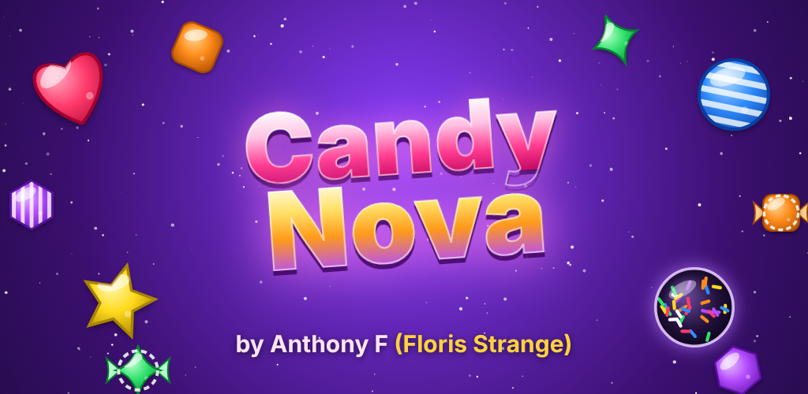

# 🍬 Candy Nova — by Anthony F (Floris Strange)

Un jeu de bonbons à aligner (« match‑3 ») dans l'espace, pour Android, avec **2000 niveaux** de plus en plus durs.



## Le jeu

- **2000 niveaux** répartis dans **100 mondes** (20 niveaux chacun) avec leurs couleurs et planètes.
  Chaque 5ᵉ niveau est « Difficile », le 20ᵉ de chaque monde est un **BOSS**.
- **Bonbons spéciaux** : rayé (4 alignés), emballé (L ou T), **Nova** (5 alignés)
  et toutes les combinaisons entre eux (Nova + Nova = **SUPERNOVA**).
- **Objectifs** : score, gelée cosmique (simple ou double), glace stellaire (1 à 3 coups),
  récolte de couleurs, cristaux d'étoile à faire descendre, bonbons en cage, plateaux de formes variées.
- **Nova Rush** : à la fin d'un niveau réussi, les coups restants deviennent des bonbons rayés qui explosent.
- 1 à 3 **étoiles** par niveau, **pièces**, **5 vies** (une vie revient toutes les 20 min),
  **bonus** (marteau, mélange, +5 coups), **boutique** (pièces gagnées en jouant), **cadeau quotidien**.
- Musique et sons générés par le code, vibrations, indices automatiques, tutoriel intégré.
- 100 % hors ligne, aucune pub, aucun achat réel, aucune donnée collectée.

## Organisation du projet

```
app/src/main/assets/www/      le jeu (HTML5 + JavaScript, aucune dépendance)
  js/engine.js                moteur : alignements, cascades, gravité, spéciaux, combos
  js/levels.js                génération déterministe des 2000 niveaux et courbe de difficulté
  js/art.js                   dessin des bonbons et obstacles
  js/audio.js                 sons et musique (Web Audio)
  js/game.js                  rendu, animations, carte, menus, sauvegarde
app/src/main/java/...         MainActivity : affiche le jeu en plein écran (WebView)
tools/test.js                 tests du moteur et des 2000 niveaux
tools/sim.js                  un robot joue les niveaux pour mesurer la difficulté
tools/make-store-assets.js    génère l'icône, la bannière et les captures du Play Store
store/                        visuels + texte de la fiche Play Store
docs/privacy-policy.html      politique de confidentialité (à publier avec GitHub Pages)
```

## Essayer le jeu tout de suite

Ouvre `app/src/main/assets/www/index.html` dans Chrome (mode téléphone avec F12 → icône mobile).

## Obtenir l'application Android

À chaque `push`, GitHub Actions (onglet **Actions**) teste le jeu puis compile :

- **CandyNova-debug-apk** : un APK à installer directement sur ton téléphone pour tester ;
- **CandyNova-release-aab** : le fichier `.aab` à envoyer sur le Play Store.

Pour compiler sur ton ordinateur : installe Android Studio, ouvre ce dossier, puis
`./gradlew assembleDebug` (APK) ou `./gradlew bundleRelease` (AAB).

## Publier sur le Play Store

1. **Compte développeur** Google Play : <https://play.google.com/console> (25 $ une seule fois).
2. **Créer une clé de signature** (à garder précieusement, ne jamais la perdre ni la publier) :
   ```bash
   keytool -genkeypair -v -keystore candynova-upload.jks -alias candynova \
     -keyalg RSA -keysize 2048 -validity 10000
   ```
3. **Donner la clé à GitHub** (Settings → Secrets and variables → Actions → *New repository secret*) :
   | Secret | Valeur |
   |---|---|
   | `CANDYNOVA_KEYSTORE_BASE64` | résultat de `base64 -w0 candynova-upload.jks` |
   | `CANDYNOVA_KEYSTORE_PASSWORD` | mot de passe du keystore |
   | `CANDYNOVA_KEY_ALIAS` | `candynova` |
   | `CANDYNOVA_KEY_PASSWORD` | mot de passe de la clé |

   (En local, tu peux à la place créer un fichier `keystore.properties` à la racine avec
   `storeFile`, `storePassword`, `keyAlias`, `keyPassword` — il est ignoré par git.)
4. Relance le workflow **Build Android** et télécharge l'artefact **CandyNova-release-aab** (signé).
5. Dans la Play Console : *Créer une application* → nom **Candy Nova**, type **Jeu**, **Gratuit**.
   Remplis la fiche avec `store/fiche-play-store.md` et les images du dossier `store/`.
6. **Politique de confidentialité** : active GitHub Pages (Settings → Pages → branche `main`, dossier `/docs`)
   et indique l'URL de `privacy-policy.html`. Pense à y ajouter ton e-mail de contact.
7. Envoie l'`.aab` en **test interne**, puis en **production** (les nouveaux comptes personnels doivent
   d'abord faire un test fermé avec 12 testeurs pendant 14 jours).

Pour chaque mise à jour, augmente `versionCode` (et `versionName`) dans `app/build.gradle`.

## Menu admin et codes cadeaux

- Chaque joueur a un **code joueur** (Réglages → « Ton code joueur »).
- **Réglages → 🔐 Admin** → mot de passe → choisis le code du joueur (ou « tous les joueurs »),
  les jetons et les bonus → **Créer le code cadeau** → envoie le code au joueur.
- Le joueur le colle dans **Réglages → 🎁 Entrer un code cadeau**. Un code ne marche qu'une fois,
  et seulement pour le joueur visé.
- « Me les donner directement » ajoute les jetons sur l'appareil de l'admin.
- Les codes sont signés (ECDSA) : le jeu ne contient que la clé publique et la clé privée
  chiffrée par le mot de passe. Sans le mot de passe, personne ne peut fabriquer de code.
- Changer le mot de passe (invalide les anciens codes) :
  `node tools/admin-password.js "nouveau mot de passe"` puis commit de `js/admin-key.js`.

## Tests

```bash
node tools/test.js            # valide les 2000 niveaux et le moteur
node tools/sim.js 1 2000 50 4 # le robot joue 1 niveau sur 50, 4 parties chacun
```
